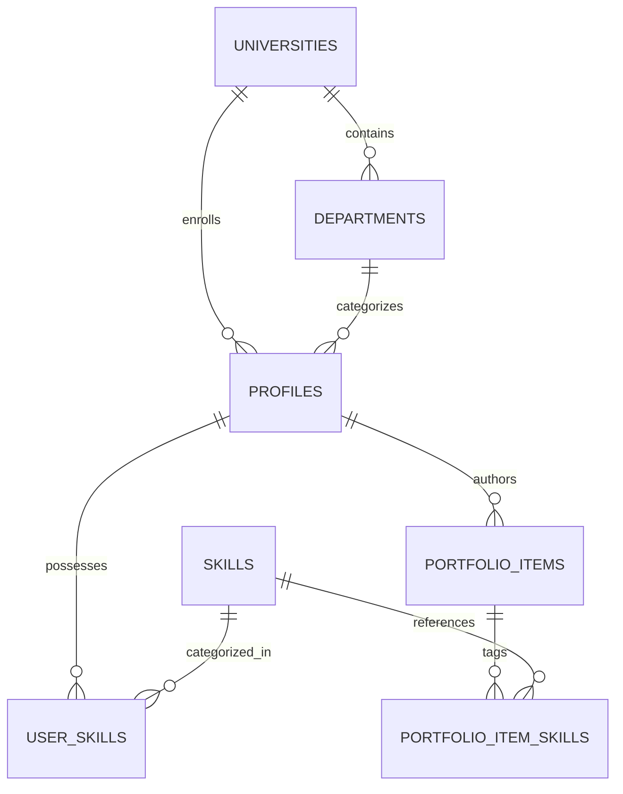

# SkillBridge Database Architecture

## Overview
SkillBridge uses Supabase PostgreSQL (15+) as its core persistence engine, employing UUID v4 primary keys, strict foreign key constraints, updated_at triggers, and comprehensive Row Level Security (RLS) on every table.

---

## 1. Schema Entities

### 1.1 `universities`
Stores institutional campus records. Configured with optional email domain verification.

| Column | Type | Constraints | Description |
|---|---|---|---|
| `id` | `UUID` | `PRIMARY KEY DEFAULT gen_random_uuid()` | Unique university ID |
| `name` | `TEXT` | `NOT NULL` | Full university name |
| `short_name` | `TEXT` | | Abbreviated name (e.g. "Apex Tech") |
| `email_domain` | `TEXT` | `NULLABLE` | Campus email domain (e.g. `campus.edu`). If `NULL`, open testing is permitted |
| `is_active` | `BOOLEAN` | `NOT NULL DEFAULT true` | Active flag |
| `created_at` | `TIMESTAMPTZ` | `NOT NULL DEFAULT now()` | Creation timestamp |
| `updated_at` | `TIMESTAMPTZ` | `NOT NULL DEFAULT now()` | Last update timestamp |

### 1.2 `departments`
Academic departments under universities.

| Column | Type | Constraints | Description |
|---|---|---|---|
| `id` | `UUID` | `PRIMARY KEY DEFAULT gen_random_uuid()` | Unique department ID |
| `university_id` | `UUID` | `NOT NULL REFERENCES universities(id) ON DELETE CASCADE` | Parent institution |
| `name` | `TEXT` | `NOT NULL` | Department name |
| `created_at` | `TIMESTAMPTZ` | `NOT NULL DEFAULT now()` | Creation timestamp |
| `updated_at` | `TIMESTAMPTZ` | `NOT NULL DEFAULT now()` | Last update timestamp |

*Constraint:* `UNIQUE (university_id, name)`

### 1.3 `profiles`
The primary user record, linked 1:1 with Supabase `auth.users(id)`. Extended in Milestone 2.

| Column | Type | Constraints | Description |
|---|---|---|---|
| `id` | `UUID` | `PRIMARY KEY REFERENCES auth.users(id) ON DELETE CASCADE` | Auth user ID |
| `university_id` | `UUID` | `REFERENCES universities(id) ON DELETE SET NULL` | Campus affiliation |
| `department_id` | `UUID` | `REFERENCES departments(id) ON DELETE SET NULL` | Department affiliation |
| `full_name` | `TEXT` | `NOT NULL` | User full name |
| `email` | `TEXT` | `NOT NULL` | Registered university email |
| `avatar_url` | `TEXT` | | Profile avatar image URL |
| `course` | `TEXT` | | Program of study (e.g. B.Tech CS) |
| `academic_year` | `TEXT` | | Year (1st, 2nd, 3rd, 4th, PG) |
| `headline` | `TEXT` | | Professional student headline |
| `bio` | `TEXT` | | Extended biography |
| `availability_status`| `TEXT` | `DEFAULT 'available' CHECK ('available', 'limited', 'busy', 'unavailable')` | Availability status |
| `availability_note` | `TEXT` | | Context (e.g. "Available on weekends") |
| `available_from` | `DATE` | | Earliest available date for projects |
| `areas_of_interest` | `TEXT[]` | `DEFAULT '{}'` | Tags of personal interest |
| `contact_links` | `JSONB` | `DEFAULT '{}'::jsonb` | Opt-in links (LinkedIn, GitHub, Website) |
| `onboarding_completed` | `BOOLEAN` | `DEFAULT false` | Guided wizard status |
| `is_seeker_enabled` | `BOOLEAN` | `DEFAULT true` | Dual capability: hire talent |
| `is_freelancer_enabled` | `BOOLEAN` | `DEFAULT true` | Dual capability: offer skills |
| `platform_role` | `TEXT` | `DEFAULT 'user' CHECK ('user', 'admin', 'moderator')` | Role for moderation |
| `account_status` | `TEXT` | `DEFAULT 'active' CHECK ('active', 'suspended', 'deactivated')` | Lifecycle status |
| `last_active_at` | `TIMESTAMPTZ` | `DEFAULT now()` | Last online timestamp |
| `created_at` | `TIMESTAMPTZ` | `DEFAULT now()` | Record created |
| `updated_at` | `TIMESTAMPTZ` | `DEFAULT now()` | Record updated |

### 1.4 `skills`
Central approved and proposed taxonomy of technical, creative, and managerial skills.

| Column | Type | Constraints | Description |
|---|---|---|---|
| `id` | `UUID` | `PRIMARY KEY DEFAULT gen_random_uuid()` | Unique skill ID |
| `name` | `TEXT` | `NOT NULL UNIQUE` | Unique skill title |
| `category` | `TEXT` | `CHECK ('Technical', 'Creative', 'Management & Other')` | Skill category |
| `is_approved` | `BOOLEAN` | `DEFAULT true` | Admin approval status |
| `created_at` | `TIMESTAMPTZ` | `DEFAULT now()` | Creation timestamp |

### 1.5 `user_skills`
Junction table linking student profiles to claimed skills with self-reported proficiency.

| Column | Type | Constraints | Description |
|---|---|---|---|
| `id` | `UUID` | `PRIMARY KEY DEFAULT gen_random_uuid()` | Unique user skill ID |
| `user_id` | `UUID` | `REFERENCES profiles(id) ON DELETE CASCADE` | Profile owner |
| `skill_id` | `UUID` | `REFERENCES skills(id) ON DELETE CASCADE` | Claimed skill |
| `proficiency` | `TEXT` | `DEFAULT 'beginner' CHECK ('beginner', 'intermediate', 'advanced')` | Self-reported level |
| `is_primary` | `BOOLEAN` | `DEFAULT false` | Highlighted on card |
| `created_at` | `TIMESTAMPTZ` | `DEFAULT now()` | Creation timestamp |

*Constraint:* `UNIQUE (user_id, skill_id)`

### 1.6 `portfolio_items` (Added in 002)
Self-reported student projects, previous work, GitHub repositories, and creative assets.

| Column | Type | Constraints | Description |
|---|---|---|---|
| `id` | `UUID` | `PRIMARY KEY DEFAULT gen_random_uuid()` | Unique portfolio item ID |
| `user_id` | `UUID` | `NOT NULL REFERENCES profiles(id) ON DELETE CASCADE` | Project owner |
| `title` | `TEXT` | `NOT NULL` | Project title |
| `description` | `TEXT` | | Project summary and deliverables |
| `category` | `TEXT` | | Categorization (e.g. Web Dev, Design) |
| `thumbnail_url` | `TEXT` | | Preview visual or document cover |
| `project_url` | `TEXT` | | External demo or live link |
| `github_url` | `TEXT` | | Code repository link |
| `attachment_url` | `TEXT` | | Optional attachment/document link |
| `completed_date` | `DATE` | | Completion date |
| `created_at` | `TIMESTAMPTZ` | `NOT NULL DEFAULT now()` | Record created |
| `updated_at` | `TIMESTAMPTZ` | `NOT NULL DEFAULT now()` | Record updated |

### 1.7 `portfolio_item_skills` (Added in 002)
Junction linking portfolio entries to relevant skills utilized during project execution.

| Column | Type | Constraints | Description |
|---|---|---|---|
| `portfolio_item_id` | `UUID` | `NOT NULL REFERENCES portfolio_items(id) ON DELETE CASCADE` | Portfolio entry |
| `skill_id` | `UUID` | `NOT NULL REFERENCES skills(id) ON DELETE CASCADE` | Utilized skill |
| `created_at` | `TIMESTAMPTZ` | `NOT NULL DEFAULT now()` | Creation timestamp |

*Constraint:* `PRIMARY KEY (portfolio_item_id, skill_id)`

---

## 2. Storage Buckets (Supabase Storage)

1. **`avatars`**:
   - Public read access for rendering profile photographs across the platform.
   - Max file size: 5MB.
   - Allowed MIME types: `image/jpeg`, `image/png`, `image/webp`.
   - Write/Delete operations strictly isolated to authenticated user's own prefix folder (`storage.foldername(name)[1] = auth.uid()::text`).

2. **`portfolio-media`**:
   - Public read access for portfolio project previews and attachments.
   - Max file size: 5MB.
   - Allowed MIME types: `image/jpeg`, `image/png`, `image/webp`, `application/pdf`.
   - Write/Delete operations isolated to owner.

---

## 3. Database Triggers

1. **`on_auth_user_created`**:
   - Executes `handle_new_user()` with `SECURITY DEFINER SET search_path = public` upon user registration in `auth.users`.
2. **`trg_prevent_role_escalation`**:
   - Restricts modification of `platform_role` to users who already possess the `admin` role.
3. **`trg_*_updated_at`**:
   - Automatically maintains `updated_at = now()` across `universities`, `departments`, `profiles`, and `portfolio_items`.
